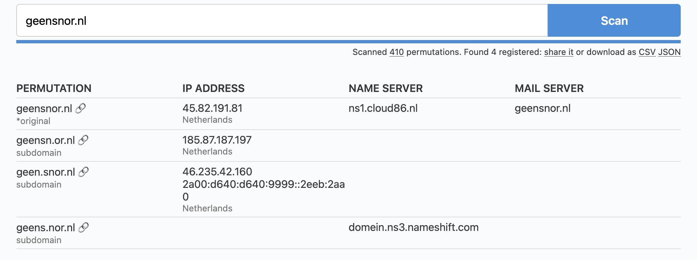

Ik werk bij een website die meer dan 50 miljoen bezoekers per jaar trekt. Onze domeinnaam (en merknaam) is heel bekend en we hebben een superbetrouwbaar imago.

## Subdomeinen

Een van mijn verantwoordelijkheden is het stabiel houden van alle productieomgevingen. Daar hoort ook een beveiligingsaspect bij. Ik was al langer gefascineerd door de gevoelige informatie die websites via DNS-records lekken en ben daar verder ingedoken. Met sites als Shodan breng je eenvoudig subdomeinen van een domein in kaart, zoals [hier](https://www.shodan.io/domain/geensnor.nl). Via die subdomeinen vind je al snel allerlei backendsystemen, **interne portalen** of andere initiatieven van een organisatie, en vaak ook 'vergeten' projecten die niet meer helemaal up-to-date zijn: de zogenoemde **schaduw-IT**. Ook ben je al snel kwetsbaar voor **subdomain takeovers**: een DNS-record verwijst dan naar een externe service die niet meer bestaat. Een aanvaller kan die service claimen en daarmee controle krijgen over het subdomein.

Ik maakte een handig tooltje om direct alle gevonden subdomeinen in je browser te openen: [SubDomainTabber](https://github.com/Zuijdam/SubdomainTabber). Zo kun je sneller kijken wat er allemaal te vinden is. Een kleine waarschuwing: er zit geen rem op en het tooltje opent hupsakee 50 tabbladen als je niet uitkijkt.

Nog aardig om te vermelden is dat het vinden van een subdomein geen eenvoudige bedoeling is. Immers, die DNS entries zijn niet zomaar op te vragen. Eigenlijk is de meest gebruikte manier, ook van Shodan, om dat te doen met gepubliceerde certificaten waarin wel die informatie is te vinden, bijvoorbeeld via [crt.sh](https://crt.sh/). Als je bijvoorbeeld kijkt naar de [crt.sh record van geensnor](https://crt.sh/?q=geensnor.nl), dan zie je daar opeens alle subdomeinen maar ook de complete **historie** terug, zoals verwijzingen naar het illustere **Geensnor Yasp**. Een handige tool met een normale GUI hiervoor is, naast Shodan, bijv. Merklemap waar een actueel overzicht te vinden is van de [geensnor subdomeinen](https://www.merklemap.com/search?query=geensnor.nl)

## Domeinsquatting

Als je de naam van mijn werkgever zegt, dan kent iedereen dat en weet iedereen dat wij compleet transparant, wetenschappelijk onderbouwd en eerlijk zijn. Ik wil verder hier de naam niet noemen want dat doet niet ter zake, maar we zijn een sterk merk en dus wordt daar misbruik van gemaakt. Het is een interessante **attack vector** om je voor te doen als ons en mee te liften op onze betrouwbaarheid, maar ondertussen bijv. een phishingcampagne uit te voeren. Een manier waarop dat veel gebeurt is het zogenoemde **domeinsquatting** waarbij een aanvaller een domein claimt dat sterk lijkt op de echte naam maar vaak een klein foutje bevat, bijv gensnor.nl of wwwgeensnor.nl.

Zo ontdekte ik in 1 van mijn zoektochten een zeer verdachte registratie waarin inderdaad alleen de punt tussen www en het merknaam was verwijderd. Een topje van de ijsberg bleek want na een zoektocht met een tool genaamd [dnstwist](https://github.com/elceef/dnstwist) ontdekten we nog veel meer registraties waarin er duidelijk misbruik werd gemaakt van onze naam en er allerlei andere registraties met kleine typo's bleken te bestaan. dnstwist is wel een leuke tool. Het genereert allemaal varianten van je domeinnaam en controleert vervolgens of er een registratie op te vinden, een DNS-record op zit en of er een mailserver bekend is. Er is trouwens een [webversie van dnstwist](https://dnstwist.it/). En om te zorgen dat ik voortaan eerder op de hoogte ben van foute domeinen die zich voordoen als ons implementeerde ik een **GitHub action met dnstwist** die iedere nacht de scan van de vorige dag vergelijkt en een melding geeft als er iets nieuws wordt ontdekt.

## ok...en wat deed je toen?

Toen had ik een lijst van verdachte domeinnamen en moest ik die offline gaan laten halen. Dat betekent contact opnemen met de registrar, de domeinhouder en SIDN. We hebben een aantal invalshoeken die we kunnen kiezen waaronder bijv. via een juridische weg (inbreuk op merknaam) maar handiger (tip) is om even kritisch te kijken naar de **houdergegevens**. Immers, deze moeten kloppen en gegevens tonen van een bestaand rechtspersoon. Maar partijen die kwaad willen, vullen daar bijna altijd niet-bestaande gegevens in, en dat is (soms) een reden voor SIDN om een domein direct offline te halen of op te schorten. Een kort berichtje naar SIDN is voldoende, scheelt je toch weer een hele juridische soap.
